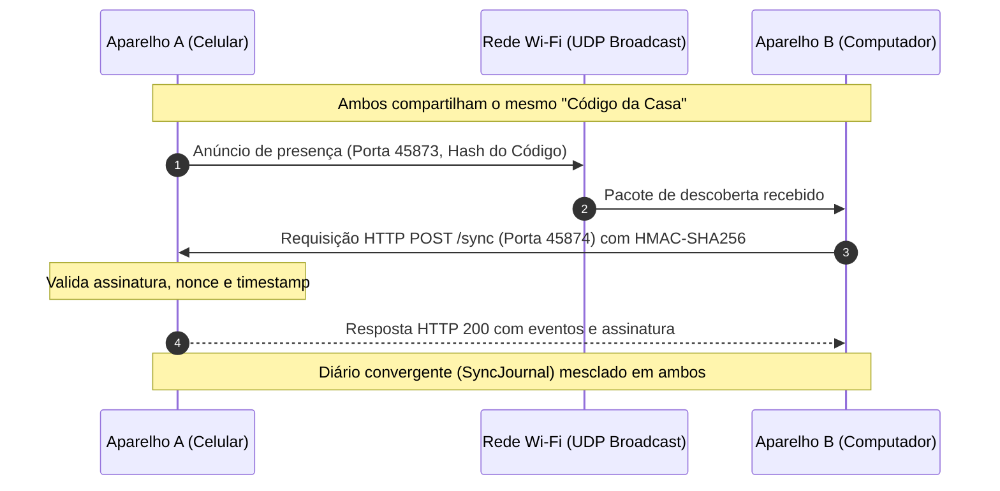

<div align="center">


# Despensa Smart

**A despensa inteligente da sua casa: menos desperdício, mais possibilidades.**

Um aplicativo moderno, *local-first*, multiplataforma e com design system inspirado no **Liquid Glass**, desenvolvido em **Flutter** para gerenciar mantimentos, combater o desperdício com receitas inteligentes, organizar listas de compras com controle financeiro e sincronizar dados entre aparelhos da casa sem depender da nuvem.

---

[](https://flutter.dev)
[](https://dart.dev)
[](https://m3.material.io)
[](https://github.com)
[](https://opensource.org/licenses/MIT)
[](https://flutter.dev)

</div>

---

## 📑 Sumário

- [Visão Geral](#-visão-geral)
- [Principais Funcionalidades](#-principais-funcionalidades)
- [Design System: Liquid Glass](#-design-system-liquid-glass)
- [Arquitetura do Projeto](#-arquitetura-do-projeto)
- [Protocolo de Sincronização Local (LAN Sync)](#-protocolo-de-sincronização-local-lan-sync)
- [Notificações e Segundo Plano](#-notificações-e-segundo-plano)
- [Telas do Aplicativo](#-telas-do-aplicativo)
- [Como Executar](#-como-executar)
- [Configuração de Ícones Nativos](#-configuração-de-ícones-nativos)
- [Privacidade e Segurança](#-privacidade-e-segurança)
- [Licença](#-licença)

---

## 🌟 Visão Geral

O **Despensa Smart** resolve o problema diário de esquecer o que há na despensa, perder prazos de validade e comprar mantimentos duplicados. Construído sobre o paradigma **Local-First**, seus dados pertencem 100% a você: nada é enviado para servidores de terceiros ou nuvens corporativas.

Diferente de aplicativos convencionais que exigem logins lentos e conexão constante, o Despensa Smart abre instantaneamente, funciona offline e permite que todos os celulares e computadores da mesma residência compartilhem a despensa através da rede Wi-Fi local de forma autônoma e segura.

---

## 🚀 Principais Funcionalidades

### 🥫 1. Gestão Completa da Despensa
- **Cadastro Ágil**: Adicione itens informando nome, quantidade, unidade de medida, categoria e data de validade.
- **Filtros Rápidos & Ordenação**:
  - Filtros de status com um toque: *Todos*, *Para conferir* (validade próxima ou vencida), *Esgotados* e *Nas compras*.
  - Filtro por categorias: *Legumes, Frutas, Carnes, Laticínios, Grãos, Bebidas, Enlatados, Condimentos, Doces, Congelados, Outros*.
  - Ordenação dinâmica por *Nome (A-Z)*, *Data de Validade* ou *Menor Estoque*.
- **Ações Imediatas nos Cards**:
  - **Consumir**: Reduz a quantidade informada. Se o item zerar, pode ser enviado automaticamente para as compras.
  - **Repor**: Adiciona quantidades diretamente sem necessidade de recadastrar.
  - **Na lista de compras**: Alterna a inclusão no carrinho com um toque.
  - **Editar / Excluir**: Controle total sobre as informações cadastradas.

### 🍳 2. Recomendação Inteligente de Receitas
- **Integração Real com TheMealDB**: Consulta receitas autênticas na API aberta com lista detalhada de ingredientes, medidas e instruções de preparo.
- **Prioridade Anti-desperdício**: Ingredientes com prazo de vencimento próximo ganham prioridade absoluta na sugestão culinária.
- **Cálculo de Cobertura da Despensa**: Cada card de receita exibe visualmente quantos ingredientes você já possui em casa e a barra de aproveitamento percentual antes mesmo de abrir.
- **Filtro de Segurança**: Produtos vencidos ou com estoque zerado são automaticamente excluídos das buscas.

### 🛒 3. Carrinho de Compras, Histórico & Resumo Mensal
- **Carrinho com Controle Financeiro**:
  - Adicione itens da lista ou de toda a despensa.
  - Informe quantidade comprada, preço unitário e desconto obtido.
  - Totalização automática de gastos e descontos em centavos (sem erros de arredondamento de ponto flutuante).
- **Checkout Atômico**: Ao finalizar a compra, o estoque dos produtos é atualizado imediatamente e o recibo é registrado no histórico da casa.
- **Histórico Detalhado**: Consulte cada compra realizada por data, itens, descontos e valores pagos.
- **Resumo Mensal Comparativo**:
  - Comparativo mês a mês de gastos e descontos com indicador percentual de variação.
  - Destaques de consumo: itens mais consumidos e menos consumidos por unidade.
  - Média de consumo diário por item e unidade.

### 🔔 4. Notificações Inteligentes & Monitoramento em Segundo Plano
- **Lembretes de Validade no Sistema Operacional**: Notificações locais agendadas com horário personalizável (padrão: 09:00).
- **Alerta de Estoque Baixo ou Zerado**: Avisa quando mantimentos essenciais atingem o limite crítico (limite global ajustável ou limites específicos por produto).
- **Sugestões Periódicas de Receitas**: Notificação diária com receitas selecionadas para os ingredientes disponíveis.
- **Botão de Teste**: Dispara imediatamente uma notificação de verificação para validar permissões do aparelho.

### 📡 5. Sincronização Segura na Rede Local (LAN Sync)
- **Zero Nuvem**: Compartilhe a despensa com todos da casa pelo Wi-Fi local sem contas, senhas ou servidores remotos.
- **Descoberta Automática UDP**: Aparelhos na mesma rede se encontram automaticamente.
- **Conexão Manual por IP**: Suporte a inserção direta de IP:Porta caso o roteador bloqueie multicast.
- **Código da Casa Seguro**: Trocas autenticadas com chaves criptográficas de 192 bits e HMAC-SHA256.

### ⚙️ 6. Central de Configurações & Backup
- **Personalização de Visual**: Tema Claro, Escuro ou Sistema; ajuste de intensidade do efeito Liquid Glass (*Suave*, *Padrão*, *Intenso*); ativação de orbes luminosos e cartões compactos.
- **Padrões da Despensa**: Categoria padrão, unidade padrão, ordenação padrão e prazo do alerta de validade (3, 5, 7, 14 ou 30 dias).
- **Exportação e Importação de Backup JSON**: Exporte todos os dados em formato legível e restaure ou mescle em qualquer aparelho.
- **Ações de Limpeza Seguras**: Desmarcar toda a lista de compras, remover produtos esgotados, restaurar padrões de fábrica ou zerar a despensa com proteção por diálogo de confirmação.

---

## 🎨 Design System: Liquid Glass

O aplicativo foi desenhado com base no conceito **Liquid Glass**, combinando profundidade espacial, superfícies foscas translúcidas e refrações vibrantes:

```
┌────────────────────────────────────────────────────────────┐
│                    LiquidGlassBackground                   │
│   (Gradiente base esmeralda escuro + Orbes luminosos)      │
│                                                            │
│  ┌──────────────────────────────────────────────────────┐  │
│  │                  LiquidGlassAppBar                   │  │
│  │         (BackdropFilter blur + Borda especular)      │  │
│  └──────────────────────────────────────────────────────┘  │
│                                                            │
│  ┌──────────────────────────────────────────────────────┐  │
│  │                  LiquidGlassCard                     │  │
│  │  - Efeito vidro jateado com desfoque gaussiano       │  │
│  │  - Gradiente de preenchimento com canal alfa sutil   │  │
│  │  - Borda translúcida de 1.2px simulando luz ambiente │  │
│  │  - Sombreamento suave de elevação 3D                 │  │
│  └──────────────────────────────────────────────────────┘  │
│                                                            │
│  ┌──────────────────────────────────────────────────────┐  │
│  │                 LiquidGlassBottomNav                 │  │
│  │         (Cápsula flutuante arredondada + Badges)     │  │
│  └──────────────────────────────────────────────────────┘  │
└────────────────────────────────────────────────────────────┘
```

### Paleta de Cores

| Tom | Hexadecimal | Papel no Design |
|---|---|---|
| **Deep Forest** | `#082B20` / `#0A1410` | Fundo principal e base dos gradientes no modo escuro |
| **Emerald Primary** | `#14634A` / `#175B45` | Destaque principal, botões e cartões de status |
| **Luminous Mint** | `#8BE2BF` / `#94D6B8` | Ícones em modo escuro, refrações e texto de contraste |
| **Warm Gold** | `#F3C86A` / `#D9A33E` | Indicadores de atenção, brotos luminosos e badges de receitas |
| **Soft Amber** | `#B85C19` / `#FFB784` | Avisos de validade próxima e estoque em conferência |
| **Pure White** | `rgba(255,255,255, 0.85)` | Bordas especulares de reflexão dos cartões de vidro |

---

## 🏗️ Arquitetura do Projeto

O projeto é estruturado em uma arquitetura limpa, desacoplada e orientada a serviços:

```
lib/
├── constants/
│   └── categories.dart              # Categorias oficiais, unidades de medida e valores padrão
├── data/
│   └── pantry_database.dart         # Camada de banco de dados, transações atômicas e backup JSON
├── models/
│   ├── pantry_item.dart             # Entidade do item da despensa (estoque, unidade, validade, status)
│   ├── purchase_line.dart           # Linha de compra do carrinho (preço unitário, descontos, totais)
│   └── recipe.dart                  # Entidade de receita, ingredientes, matching e instruções
├── services/
│   ├── app_settings_service.dart    # Gerenciador central de preferências e personalização
│   ├── date_formatter.dart          # Formatação consistente de datas locais
│   ├── expiry_notice_planner.dart   # Planejador de agenda de alertas de validade civil
│   ├── expiry_notification_service.dart # Serviço de agendamento de notificações locais
│   ├── ingredient_names.dart        # Normalização e busca canônica imune a acentos
│   ├── monthly_consumption.dart     # Métricas agregadas de consumo e rankings mensais
│   ├── pantry_background_service.dart   # Worker de segundo plano (Workmanager / Background tasks)
│   ├── pantry_notification_plan.dart# Planejador do estado de estoque e receitas
│   ├── recipe_service.dart          # Cliente HTTP da API TheMealDB com cache em memória
│   ├── theme_service.dart           # Carregamento e montagem dos temas Claro e Escuro
│   └── validation_service.dart      # Validadores de formulários e quantidades numéricas
├── sync/
│   ├── lan_sync.dart                # Interface de exportação condicional (Web stub vs Native)
│   ├── lan_sync_native.dart         # Motor P2P local (HTTP Server + UDP Datagram Broadcast)
│   ├── lan_sync_stub.dart           # Implementação neutra para Web sem sockets TCP/UDP
│   ├── sync_auth.dart               # Autenticação criptográfica HMAC-SHA256 e nonces
│   └── sync_journal.dart            # Diário convergente de operações (CRDT / Relógio de Lamport)
├── views/
│   ├── widgets/
│   │   ├── empty_state.dart         # Estados vazios estilizados em vidro
│   │   ├── expiry_warning_banner.dart # Banner de aviso de validade próxima
│   │   ├── lan_sync_settings.dart   # Widget de configuração e status da rede local
│   │   ├── liquid_glass.dart        # Componentes do design system Liquid Glass
│   │   ├── pantry_item_card.dart    # Cartão interativo do item da despensa
│   │   ├── pantry_notification_settings.dart # Configurações de notificações e limites
│   │   ├── pantry_overview.dart     # Painel de resumo superior com métricas interativas
│   │   ├── purchase_dialog.dart     # Diálogo de compra com quantidade, valor e desconto
│   │   ├── recipe_card.dart         # Card de receita com aproveitamento e modal detalhado
│   │   └── stock_dialog.dart        # Diálogo numérico de reposição e consumo
│   ├── add_item_screen.dart         # Formulário de cadastro de ingredientes
│   ├── edit_item_screen.dart        # Formulário de edição de itens
│   ├── home_screen.dart             # Tela principal com abas de Despensa e Receitas
│   ├── onboarding_screen.dart       # Apresentação interativa de recursos e assistente de permissões
│   ├── purchase_history_screen.dart # Histórico de compras finalizadas e Resumo Mensal
│   ├── recipe_inbox_screen.dart     # Caixa de entrada de receitas descobertas em 2º plano
│   ├── settings_screen.dart         # Painel geral de configurações e manutenção
│   └── shopping_list_screen.dart    # Carrinho de compras e gerenciamento de lista
└── main.dart                        # Ponto de entrada, inicialização assíncrona e roteamento
```

---

## 📡 Protocolo de Sincronização Local (LAN Sync)

A sincronização entre aparelhos utiliza arquitetura distribuída **sem servidor central**:



### Características Técnicas do LAN Sync:
- **Descoberta:** UDP IPv4 na porta `45873`.
- **Canal de Dados:** HTTP REST local na porta `45874`.
- **Autenticação:** Assinatura `x-pantry-signature` calculada com HMAC-SHA256 derivada da chave de 192 bits do código da casa.
- **Proteção contra Replay:** Cada requisição inclui um `nonce` único gerado criptograficamente e verificação de desvio de relógio menor que 5 minutos.
- **Convergência de Conflitos:** Implementação baseada em diário de eventos imutáveis com **Relógio Lógico de Lamport**. Se dois aparelhos consumirem ou adicionarem o mesmo item ao mesmo tempo, as quantidades convergem de forma determinística sem sobrescrever dados.

---

## 🔔 Notificações e Segundo Plano

O Despensa Smart oferece suporte completo a monitoramento nativo em segundo plano respeitando as diretrizes de cada plataforma:

| Plataforma | Mecanismo de Segundo Plano | Agendamento de Validade |
|---|---|---|
| **Android** | `Workmanager` (tarefas periódicas a cada 6h) | `flutter_local_notifications` com reinicialização em boot |
| **iOS** | `BGTaskScheduler` com modo `fetch` | Notificações locais agendadas no sistema (`DarwinNotificationDetails`) |
| **Windows** | Verificação com app aberto + Lembretes agendados | Lembretes locais persistentes no Windows Notification Center |
| **macOS** | `NSBackgroundActivityScheduler` | Notificações locais com central do macOS |
| **Web** | Não executa em 2º plano (alertas visuais in-app) | Alertas no painel visual da despensa |

---

## 📱 Telas do Aplicativo

<details>
<summary><b>1. Apresentação & Permissões (OnboardingScreen)</b></summary>
Apresentação em 4 etapas guiadas apresentando controle de estoque, receitas com aproveitamento, carrinho de compras e assistente em 1 clique para ativar notificações e rede local.
</details>

<details>
<summary><b>2. Despensa Inteligente (HomeScreen - Aba Despensa)</b></summary>
Painel superior de métricas (`PantryOverview`), banner de validade próxima, barra de pesquisa com busca sem acentos, chips de status rápido, filtro de categorias, ordenação A-Z/validade/estoque e cards com ações rápidas de consumo e reposição.
</details>

<details>
<summary><b>3. Receitas Inteligentes (HomeScreen - Aba Receitas)</b></summary>
Busca online conectada ao TheMealDB que prioriza ingredientes perto do vencimento, exibe a barra percentual de itens disponíveis na despensa e abre modal com ingredientes e instruções completas.
</details>

<details>
<summary><b>4. Carrinho de Compras & Gestão de Compras (ShoppingListScreen)</b></summary>
Lista de compras com calculadora de preço unitário, descontos e total líquido por produto. Checkout com reposição automática no estoque.
</details>

<details>
<summary><b>5. Histórico & Resumo Mensal (PurchaseHistoryScreen)</b></summary>
Histórico de cupons/recibos de compras anteriores e painel analítico mensal com comparações percentuais de gastos e rankings de produtos mais e menos consumidos.
</details>

<details>
<summary><b>6. Configurações Completas (SettingsScreen)</b></summary>
Central unificada para customização de tema, refração Liquid Glass, orbes, unidades padrão, horários de lembrete de validade, exportação/importação de backup JSON e sincronização na rede local.
</details>

---

## 💻 Como Executar

### Pré-requisitos
- [Flutter SDK](https://docs.flutter.dev/get-started/install) (versão `>=3.22.0`)
- [Dart SDK](https://dart.dev/get-dart) (versão `>=3.4.0`)
- Git instalado
- Emulador ou dispositivo físico conectado (Android, iOS, Windows ou macOS)

### Instalação Passo a Passo

1. **Clone o repositório:**
   ```bash
   git clone https://github.com/seu-usuario/despensa_smart.git
   cd despensa_smart
   ```

2. **Instale as dependências:**
   ```bash
   flutter pub get
   ```

3. **Execute o aplicativo no seu dispositivo preferido:**
   ```bash
   # Executar no dispositivo padrão conectado
   flutter run

   # Executar no Windows Desktop
   flutter run -d windows

   # Executar no Android
   flutter run -d android

   # Executar no Chrome / Web
   flutter run -d chrome
   ```

4. **Executar verificação de código e testes:**
   ```bash
   flutter analyze
   flutter test
   ```

---

## 🎨 Configuração de Ícones Nativos

O projeto inclui o pipeline de geração de ícones multiplataforma via `flutter_launcher_icons: ^0.14.3`:

- Imagem mestre: [assets/app_icon.png](file:///c:/Users/aldo/Documents/DespensaSmart/assets/app_icon.png) (1024x1024 PNG em alta resolução)
- Imagem de primeiro plano adaptativo: [assets/app_icon_foreground.png](file:///c:/Users/aldo/Documents/DespensaSmart/assets/app_icon_foreground.png)

Para regenerar todos os ícones nativos (Android, iOS, Windows, macOS e Web), execute:

```bash
flutter pub run flutter_launcher_icons
```

---

## 🔒 Privacidade e Segurança

- **100% Local-First:** Nenhuma credencial pessoal, email ou senha é necessária para utilizar o app.
- **Sem Telemetria Oculta:** Não há rastreadores, SDKs de anúncios ou analytics incorporados.
- **Dados Criptograficamente Autenticados:** A sincronização na rede local só aceita pacotes assinados com HMAC-SHA256 pelo código da casa correspondente.
- **Backup Transparente:** O backup é exportado em formato JSON limpo e legível por humanos, permitindo que você guarde, inspecione e transfira seus dados livremente.

---

## 📄 Licença

Este projeto é distribuído sob a licença **MIT**. Consulte o arquivo [LICENSE](LICENSE) para obter mais informações.

---

<div align="center">
Desenvolvido com carinho para simplificar sua casa e valorizar seus alimentos. 🌿✨
</div>
